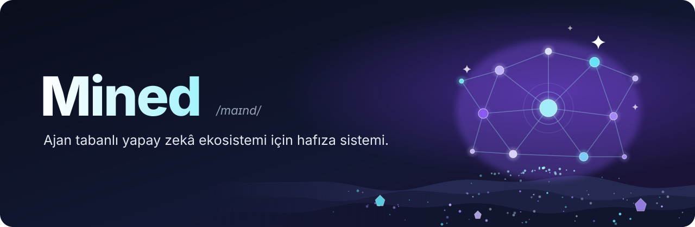
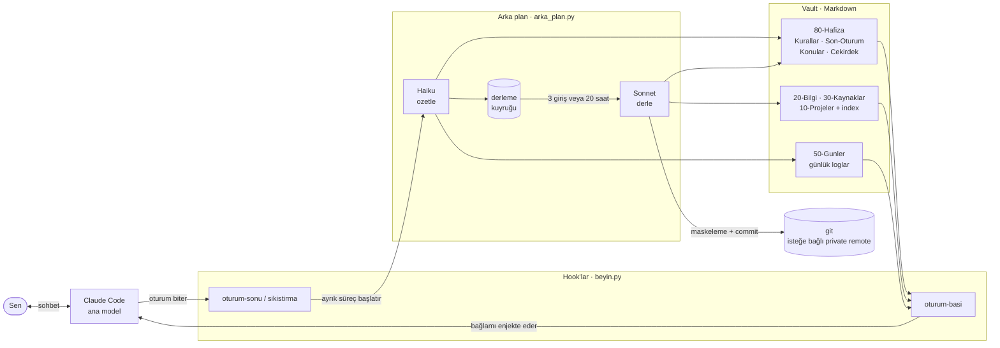

<p align="center">
  
</p>

# Mined

[Claude Code](https://claude.com/claude-code) için Türkçe bir ikinci beyin. Klasör aynı zamanda bir [Obsidian](https://obsidian.md) vault'u.

> **In English:** Mined is a Turkish second brain for [Claude Code](https://claude.com/claude-code). You chat; hooks summarize each session, a background compiler turns the summaries into wiki pages with verified citations, and the next session continues where you left off. Plain Markdown, no database, no server.

Bu klasörde `claude` yazıp sohbet edersin. Not tutmayı sistem yapar: oturum sonunda konuşma özetlenir, birkaç oturumda bir bilgi sayfalarına işlenir, sonraki oturumda Claude kaldığın yeri bilir. Her şey düz Markdown. Kendi Claude aboneliğini kullanır, ek ücret yok.

---

## Kurulum

**Gereksinimler:** [Claude Code](https://claude.com/claude-code) (giriş yapılmış), Python 3.9+, git. Obsidian isteğe bağlı.

1. Klonla ve kurulumu çalıştır:

   ```sh
   git clone https://github.com/kutaykalay/Mined.git mined
   cd mined
   python kurulum.py        # Windows: py -3 kurulum.py
   ```

   Kurulum adını sorar, hook'ları ayarlar ve Mined'ı `upstream` remote'u yapar. Güncellemeler oradan gelir, notların oraya gitmez. İstersen başka projeler için global hook'ları da ekler. Tekrar çalıştırmak güvenli.
2. Yedek istersen boş bir **private** repo aç ve bağla:

   ```sh
   git remote add origin https://github.com/<kullanıcı-adın>/<private-repon>.git
   git push -u origin main
   ```

   Vault her oturum açılışında ve her derlemede bu repoya yedeklenir.
3. `claude` yaz ve konuş. İlk oturumda kendini biraz anlat; Claude bunu `80-Hafiza/Cekirdek.md`'ye yazar.

> Kurulum yapılmadan hook'lar hiçbir şey yapmaz.

---

## Güncelleme

```sh
git pull upstream main
```

Güncellemeler yalnızca motoru değiştirir (hook'lar, skill'ler, `CLAUDE.md`, README). Notların ayrı kalır. Çakışma çıkarsa Claude'a "güncelleme çakışmasını çöz" de.

---

## Bir bakışta



Oturum başında hafıza okunur. Oturum sonunda Haiku özet yazar. Birkaç oturumda bir Sonnet özetleri bilgi sayfalarına işler.

---

## Kim neyi yazar

| Kim | Ne zaman | Nereye |
| --- | --- | --- |
| **Ana model** | "not al" deyince veya davranışını düzeltince | İlgili sayfa, `00-Gelen/`, `Kurallar.md` |
| **Haiku** (`ozetle`) | Her oturum sonunda | `50-Gunler/`, `80-Hafiza/Son-Oturum.md` |
| **Sonnet** (`derle`) | 3 giriş birikince veya 20 saatte bir | `20-Bilgi/`, `30-Kaynaklar/`, `10-Projeler/`, `80-Hafiza/`, index ve log |
| **Yedek** | Her oturum açılışında | Not yazmaz; maskeler, commit'ler, push'lar |
| **Sen** | İstediğinde | Her yere; elle yazdığın metni hiçbir model silmez |

Arka plan modelleri `claude -p --safe-mode` ile çalışır; CLAUDE.md, hook veya skill yüklemez. Haiku'nun aracı yok, sadece JSON döndürür. Sonnet sadece dosya okuyup yazabilir, komut çalıştıramaz.

**Alıntı doğrulaması.** İlk Sonnet günlüklerden iddiaları birebir alıntılarıyla çıkarır. Script her alıntıyı kaynağında arar, bulamadığını atar. İkinci Sonnet yalnızca doğrulanmış iddiaları görür. Böylece uydurma bilgi sayfalara giremez.

---

## Hafıza katmanları

| Katman | Soru | Dosyalar |
| --- | --- | --- |
| **Çalışan** | Şu an neredeyiz? | `80-Hafiza/` (Kurallar, Son-Oturum, Konular, Cekirdek) |
| **Olay** | Ne zaman ne konuştuk? | `50-Gunler/` |
| **Bilgi** | Bu konuda ne biliyoruz? | `20-Bilgi/`, `30-Kaynaklar/`, `10-Projeler/` |
| **Katalog** | Hangi sayfa var? | `20-Bilgi/index.md`, `20-Bilgi/log.md` |

Oturum başında yalnızca özetler yüklenir (en fazla 16.000 karakter). Gerisini Claude gerektiğinde açar.

---

## Klasör haritası

```
├── 00-Gelen/          Hızlı notlar
├── 10-Projeler/       Projeler
├── 20-Bilgi/          Bilgi sayfaları, index.md, log.md
├── 30-Kaynaklar/      Araçlar, kişiler, siteler
├── 50-Gunler/         Günlük loglar
├── 80-Hafiza/         Kurallar, Son-Oturum, Konular, Cekirdek
├── 90-Arsiv/          Bitenler
├── Sablonlar/         Şablonlar
├── Pano.md            Obsidian ana sayfası
├── CLAUDE.md          Ana modelin talimatları
├── kurulum.py         Kurulum
└── .claude/
    ├── settings.json      Hook tanımları
    ├── ayarlar.json       Kullanıcı ayarları (kurulum yazar)
    ├── hooks/
    │   ├── beyin.py       Bağlam yükleme, worker başlatma
    │   ├── arka_plan.py   Özet, derleme, maskeleme, git
    │   └── proje.py       Başka projeler için global hook'lar
    ├── skills/
    │   ├── beyin-bakim/   Sağlık kontrolü
    │   └── gecmis-aktar/  ChatGPT / Claude / Gemini geçmişini içe aktarma
    └── durum/             Çalışma durumu (git'e girmez)
```

---

## Kullanım

| Ne dersin | Ne olur |
| --- | --- |
| `claude` (bu klasörde) | Hafızası yüklü oturum başlar |
| "not al", "kaydet" | Hemen ilgili sayfaya yazılır |
| "böyle yapma", "daha kısa yaz" | `Kurallar.md`'ye eklenir, hemen geçerli olur |
| "bunu kaydetme" | Hiçbir yere yazılmaz |
| "derle" | Kuyruk hemen işlenir |
| "bakım yap" | `beyin-bakim` çalışır |
| "geçmişimi aktar" | Eski sohbet geçmişi içe alınır |

Log: `.claude/durum/arka_plan.log`. Arka planda bir hata olursa Claude sonraki oturumda söyler.

---

## Güvenlik

**Maskeleme.** Transkript Haiku'ya gitmeden ve her commit'ten önce taranır. API anahtarları, token'lar, şifreler, IBAN, kart ve TC kimlik numaraları `[GİZLİ: tür]` ile değiştirilir.

**Yedek.** Klasörde zaten bir remote varsa kurulum otomatik push'u sorar (varsayılan: hayır). Remote yoksa notlar yerelde commit'lenir; sonradan eklediğin remote'a push'lanır. Remote'un **private** olduğundan emin ol. Ayar: `.claude/ayarlar.json` içinde `otomatik_push`.

**Hata toleransı.** Worker'lar kilitle sıraya girer, yarıda kalan derleme kuyruğa geri döner, hook hataları oturumu bozmaz. Her derlemeden önce ve sonra commit atıldığı için bozulan not geri alınabilir.

---

## Başka projelerde kullanma (isteğe bağlı)

Kurulumda global hook'ları seçersen:

- `~/.claude/CLAUDE.md`'ye bir köprü eklenir. Başka klasördeki Claude gerektiğinde `Cekirdek.md` ve `Kurallar.md`'yi okur, proje kararlarını `10-Projeler/<proje>.md`'ye yazar.
- `~/.claude/settings.json`'a dört hook eklenir (`proje.py`):
  - **hatırlatma:** mesajın bir bilgi sayfasıyla eşleşirse Claude'a o notun yolu verilir;
  - **oturum sigortası:** projede `*save-session` komutu varsa ve kaydetmeden kapatırsan Haiku bir devir dosyası yazar.

> Vault'u taşırsan `kurulum.py`'yi yeni yerde tekrar çalıştır ve `~/.claude/settings.json`'daki eski dört satırı sil.

---

## Tasarım kararları

- **Markdown, veritabanı değil.** Hafızayı okuyup düzeltebilirsin, geçmişi git tutar.
- **İki model.** Basit iş (özet) ucuz modelde, düşünce isteyen iş (derleme) güçlü modelde.
- **Sohbet not tutmakla uğraşmaz.** Kayıt oturumdan sonra yapılır.
- **Konu başına tek sayfa.** Yeni bilgi mevcut sayfaya eklenir, çelişkiler işaretlenir.
- **Her şey Türkçe.** Teknik terimler ve kod olduğu gibi kalır.
